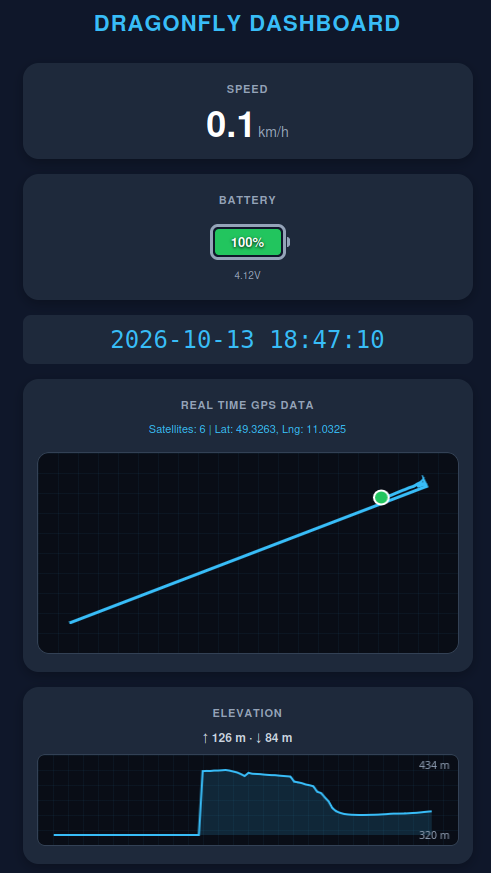
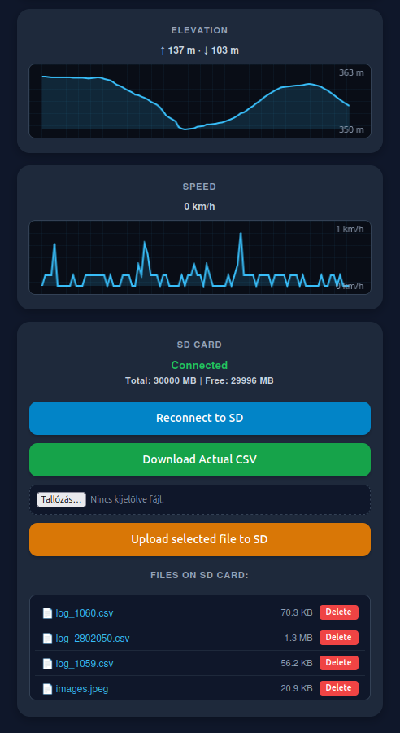
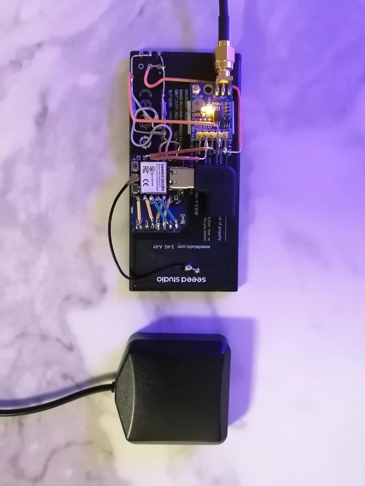

# Dragonfly Telemetry Dashboard

A robust, offline-capable, real-time e-bike telemetry dashboard built around the **Seeed Studio XIAO ESP32-C3** microcontroller. The system monitors GPS coordinates, speed, elevation profiles, and battery metrics, logging raw NMEA strings alongside structured telemetry data directly to an SD card while serving a responsive web UI via Wi-Fi.

---

## 📸 Screenshots & Hardware

### 1. Web Interface Preview
A live view of the Dragonfly dashboard showing real-time speed, battery status, GPS coordinates, elevation, and speed profiles.

### 2. Hardware Assembly & Wiring
The physical setup featuring the Seeed Studio XIAO ESP32-C3 wired to the GPS module and SD card reader.

## 🚀 System Architecture

* **Back-End (Firmware / C++):** Runs on the ESP32-C3. Handles hardware interfacing (SPI SD card, UART GPS, ADC battery monitoring), executes periodic logging, and exposes a RESTful JSON API.
* **Front-End (HTML / CSS / JavaScript):** Stored on the SD card and served dynamically to any browser. It polls the JSON API, handles DOM updates, and renders real-time vector graphics (GPS track, elevation profile, and speed profile) using the **HTML5 Canvas API**.

---

## 🔌 Hardware Pinout & Wiring

* **SD Card (SPI):**
  * **MISO:** D7 (GPIO 20)
  * **SCK:** D8 (GPIO 8)
  * **MOSI:** D9 (GPIO 9)
  * **CS:** D10 (GPIO 10)
* **GPS Module (UART):**
  * **RX:** D4 (GPIO 7)
  * **TX:** D5 (GPIO 6)
* **Battery Monitoring (ADC):**
  * **A0:** D0 (GPIO 2) with a 1:2 resistor voltage divider for safe Li-ion voltage scaling.

---

## ✨ Features
* **Offline Operation:** Generates its own Wi-Fi Access Point (`SDragonFly`).
* **SD Card Logging:** Automatically records timestamps, GPS date/time, speeds, battery voltage, percentage, GPS coordinates, satellite counts, and raw NMEA sentences into structured CSV log files.
* **Live Web Dashboard:** Real-time HTML5 Canvas rendering for GPS tracking paths, dynamic elevation profiles (with cumulative gain/loss tracking), and speed profiling.
* **File Management UI:** Web-based file manager to upload `index.html`, download active logs, and delete unwanted files directly from the browser.

## 🛠️ Development Environment & Installation

To compile and upload the firmware to the Seeed Studio XIAO ESP32-C3, follow these steps to set up your development environment.

### Prerequisites
* **Arduino IDE** (version 2.x recommended) or **PlatformIO**.
* USB-C data cable (ensure it supports data transfer, not just power charging).

### Step 1: Install ESP32 Board Support
1. Open Arduino IDE and navigate to **File > Preferences**.
2. Add the following URL to the **Additional Boards Manager URLs** field:
   `https://raw.githubusercontent.com/espressif/arduino-esp32/gh-pages/package_esp32_index.json`
3. Go to **Tools > Board > Boards Manager**, search for **esp32** by *Espressif Systems*, and install the latest version.
4. Select your board: **Tools > Board > ESP32 Arduino > Seeed Studio XIAO ESP32C3**.

### Step 2: Install Required Libraries
The project relies on standard Arduino libraries. Open the **Library Manager** (`Ctrl+Shift+I` or **Tools > Manage Libraries...**) and install:
* **TinyGPSPlus** (by Mikal Hart) - For parsing NMEA GPS data streams.
* *Note:* `WiFi`, `WebServer`, `SPI`, and `SD` are built-in libraries included with the ESP32 Arduino core package.

### Step 3: Compiling and Uploading
1. Connect your XIAO ESP32-C3 to your computer via USB-C.
2. Select the correct serial port under **Tools > Port** (e.g., `/dev/ttyACM0` on Linux or COM ports on Windows).
3. If the board fails to enter flashing mode automatically:
   * Press and hold the **BOOT** button on the board.
   * Press and release the **RESET** button.
   * Release the **BOOT** button once the upload process starts.
4. Click the **Upload** button in the Arduino IDE.